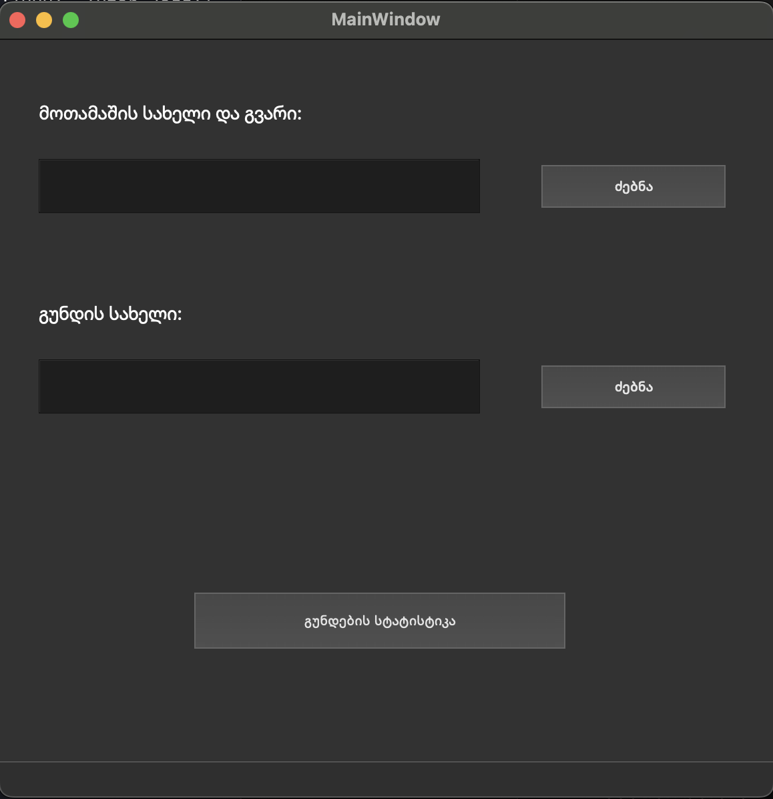
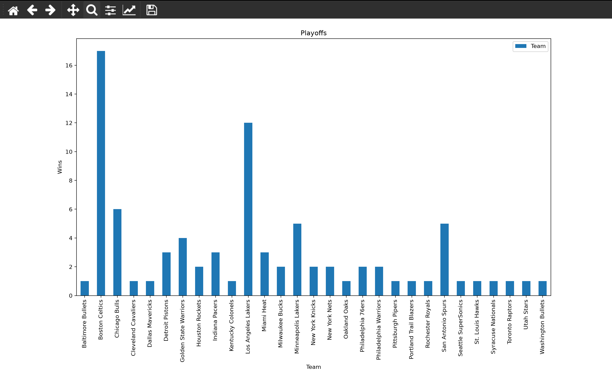
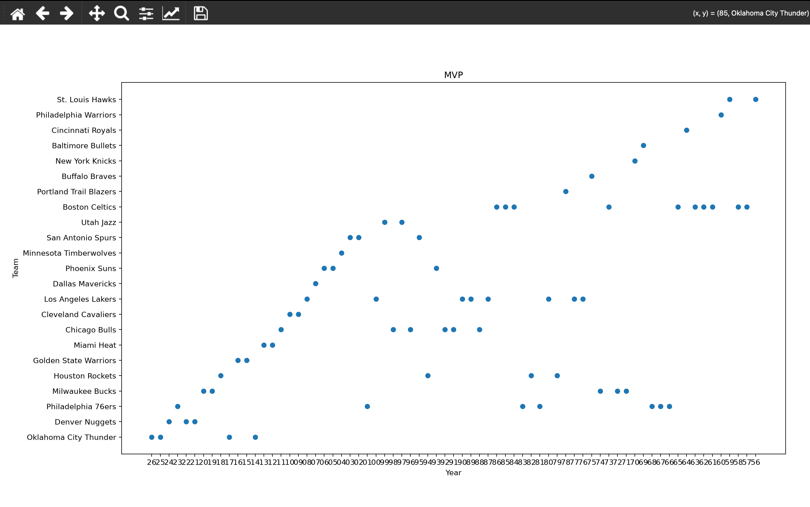

# Basketball Statistics Analyser

Python desktop app that collects and visualises NBA player and team statistics.



## Features
- **Player stats:** enter a player's name; a Selenium bot retrieves their per-game stats from basketball-reference.com, pandas processes them, and matplotlib shows charts (scoring, shooting, defence, playing time).
- **Team stats:** scrapes NBA champions and MVP winners with BeautifulSoup, stores them in SQLite, and charts playoff wins and MVPs per team.
- **MVP counter:** enter a team name to see how many MVPs it has won.

## Screenshots
| Playoff wins per team | MVPs by year |
| --- | --- |
|  |  |

## Tech
Python 3.8+ · PyQt5 · Selenium · BeautifulSoup · pandas · matplotlib · SQLite

## How to run
Requires Python 3 and Google Chrome.

1. Install the dependencies:
   ```bash
   pip3 install PyQt5 selenium pandas matplotlib beautifulsoup4 lxml requests
   ```
2. Start the app from the `Gui` folder:
   ```bash
   cd Project/Gui
   PYTHONPATH=../.. python3 main.py
   ```

## Note
This project relies on web scraping from basketball-reference.com, ESPN and Google search. If these websites change their URLs, page layout or data format, parts of the app may stop working. Currently, team statistics and the MVP counter work, but the player search no longer works because Google's search page has changed since the project was built.

## Authors
Joint university project by [Lizi Kaviladze](https://github.com/lizikaviladze14) and [Andria Inasaridze](https://github.com/andriainasaridze), 2022.

**Lizi Kaviladze's contribution:** team-statistics pipeline (MVP scraping, SQLite storage, pandas analysis, team charts) and the main GUI integration.

Originally hosted at https://github.com/andriainasaridze/Basketball_Stats
